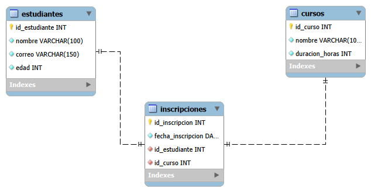

# Examen Práctico — Bases de Datos en la Nube

## Bloque 1: Diseño Relacional y SQL en la Nube

**Asignatura:** Base de Datos en la Nube  
**Estudiante:** [Nombre del estudiante]  
**Fecha:** Octubre de 2026  
**Herramientas:** MySQL Workbench, Clever Cloud y MySQL

## Descripción del proyecto

Este proyecto consiste en el diseño e implementación de una base de datos relacional para una academia de cursos en línea.

El sistema permite registrar estudiantes, administrar cursos, controlar las inscripciones y realizar consultas académicas utilizando SQL.

La base de datos fue diseñada mediante MySQL Workbench e implementada en un servicio MySQL alojado en Clever Cloud.

## Objetivos

- Diseñar un modelo entidad-relación con claves primarias y foráneas.
- Implementar relaciones uno a muchos y muchos a muchos.
- Crear las tablas mediante sentencias DDL.
- Insertar registros de prueba mediante sentencias DML.
- Ejecutar diez consultas SQL para obtener información académica.
- Documentar el procedimiento mediante capturas de pantalla.

## Modelo relacional

El sistema utiliza tres tablas:

| Tabla | Descripción |
|---|---|
| estudiantes | Almacena datos personales de los estudiantes. |
| cursos | Registra los cursos disponibles y su duración. |
| inscripciones | Relaciona estudiantes con cursos y registra la fecha de inscripción. |

La tabla `inscripciones` permite implementar la relación muchos a muchos (N:M) mediante dos claves foráneas.

### Diagrama EER

## Implementación en Clever Cloud

Se utilizó una instancia MySQL de Clever Cloud para ejecutar las instrucciones de creación de tablas y registrar los datos académicos.

La implementación contempla:

- 5 estudiantes.
- 4 cursos.
- 8 inscripciones.

### Scripts SQL

| Archivo | Descripción |
|---|---|
| [01_estructura.sql](Bloque-1-MySQL/01_estructura.sql) | DDL original exportado desde MySQL Workbench. |
| [01_estructura_clever_cloud.sql](Bloque-1-MySQL/01_estructura_clever_cloud.sql) | DDL adaptado para Clever Cloud. |
| [02_datos.sql](Bloque-1-MySQL/02_datos.sql) | Inserción de estudiantes, cursos e inscripciones. |
| [03_consultas.sql](Bloque-1-MySQL/03_consultas.sql) | Diez consultas SQL solicitadas en el examen. |

## Consultas realizadas

1. Listar los nombres y correos de todos los estudiantes.
2. Consultar los estudiantes mayores de 20 años.
3. Mostrar los cursos con duración superior a 30 horas.
4. Obtener el detalle de estudiantes y cursos inscritos.
5. Contar los estudiantes inscritos en cada curso.
6. Calcular el promedio de edad de los estudiantes.
7. Ordenar los cursos por duración descendente.
8. Consultar los inscritos en el curso Bases de Datos.
9. Obtener los cursos con al menos un estudiante inscrito.
10. Contar el total de inscripciones registradas.

Se utilizaron sentencias y funciones SQL como `SELECT`, `WHERE`, `INNER JOIN`, `LEFT JOIN`, `COUNT()`, `AVG()`, `GROUP BY`, `ORDER BY` y `DISTINCT`.

## Evidencias

Las capturas del modelo, la implementación y las diez consultas se encuentran en la carpeta `Bloque-1-MySQL/capturas`.

## Informe completo

[Consultar el informe académico del Bloque 1](Bloque-1-MySQL/informe_bloque1.md)

## Conclusión

El desarrollo del proyecto permitió aplicar conceptos fundamentales del diseño relacional, implementar tablas con integridad referencial y utilizar SQL para consultar información académica almacenada en una base de datos en la nube.
