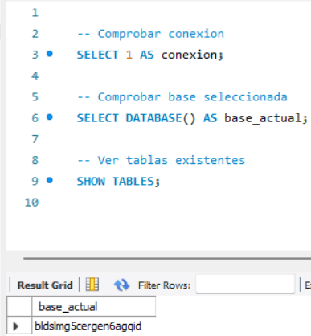
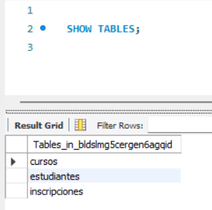
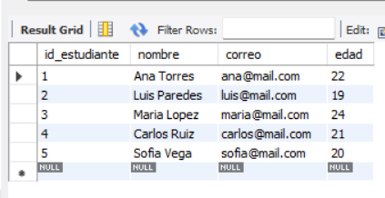
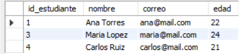
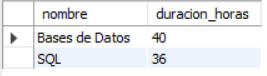
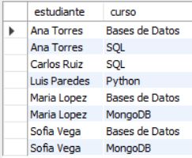
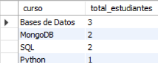
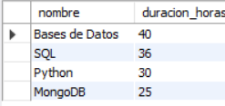
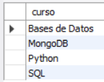

# INFORME DEL EXAMEN PRÁCTICO — BLOQUE 1

## Diseño Relacional y SQL en la Nube

**Asignatura:** Base de Datos en la Nube  
**Estudiante:** [Nombre completo]  
**Docente:** [Nombre del docente]  
**Fecha:** [Fecha de entrega]

---

## 1. Introducción

El presente informe documenta el desarrollo del Bloque 1 del examen práctico de la asignatura Base de Datos en la Nube.

La actividad consistió en diseñar e implementar una base de datos relacional para una academia de cursos en línea, utilizando MySQL Workbench para el diseño de las tablas y Clever Cloud para su alojamiento.

La implementación permite almacenar información de estudiantes, gestionar cursos y registrar las inscripciones mediante relaciones entre las tablas.

Adicionalmente, se desarrollaron diez consultas SQL para recuperar y analizar la información académica registrada.

## 2. Objetivos

### Objetivo general

Diseñar e implementar una base de datos relacional en la nube mediante MySQL, aplicando principios de integridad referencial y consultas SQL para la administración de información académica.

### Objetivos específicos

- Construir un modelo relacional utilizando MySQL Workbench.
- Definir claves primarias y foráneas para relacionar las tablas.
- Implementar la estructura de la base de datos en Clever Cloud.
- Insertar registros de estudiantes, cursos e inscripciones.
- Ejecutar diez consultas SQL y comprobar sus resultados.
- Documentar las operaciones mediante capturas de pantalla.

## 3. Herramientas utilizadas

| Herramienta | Utilidad |
|---|---|
| MySQL Workbench | Diseño del diagrama EER y ejecución de consultas SQL. |
| Clever Cloud | Alojamiento de la base de datos MySQL en la nube. |
| MySQL | Sistema de gestión de bases de datos relacional. |
| GitHub | Almacenamiento y presentación de los archivos y evidencias. |

---

## 4. Parte A — Diseño del modelo relacional

Se desarrolló un modelo entidad-relación mediante MySQL Workbench.

El modelo contiene tres tablas principales:

**Tabla estudiantes**

Almacena los datos personales de cada estudiante. Contiene los campos `id_estudiante`, `nombre`, `correo` y `edad`.

**Tabla cursos**

Registra la oferta académica mediante los campos `id_curso`, `nombre` y `duracion_horas`.

**Tabla inscripciones**

Administra la inscripción de estudiantes a cursos y contiene `id_inscripcion`, `id_estudiante`, `id_curso` y `fecha_inscripcion`.

La tabla de inscripciones utiliza claves foráneas que referencian las claves primarias de estudiantes y cursos. De esta manera, dos relaciones uno a muchos permiten implementar la relación muchos a muchos entre estudiantes y cursos.

También se definió una restricción de unicidad compuesta para impedir que un estudiante se inscriba dos veces en el mismo curso.

### Evidencia 1. Diagrama EER

*Figura 1. Modelo relacional con las tablas estudiantes, cursos e inscripciones y sus respectivas relaciones.*

---

## 5. Parte B — Implementación en la nube

### 5.1 Creación de la base de datos

Se utilizó Clever Cloud para disponer de una instancia MySQL accesible mediante conexión remota desde MySQL Workbench.

Se configuraron los parámetros de conexión proporcionados por el servicio, incluyendo servidor, puerto, usuario, contraseña y esquema asignado.

### Evidencia 2. Base de datos en Clever Cloud

*Figura 2. Servicio MySQL utilizado para almacenar la base de datos académica.*

### 5.2 Creación de las tablas

Se exportó el script SQL desde el modelo EER de MySQL Workbench y se adaptó para ejecutarlo dentro del esquema existente de Clever Cloud.

Se emplearon sentencias `CREATE TABLE`, claves primarias, claves foráneas, campos obligatorios y restricciones `UNIQUE` para garantizar la consistencia de los datos.

Las tablas creadas fueron:

- estudiantes
- cursos
- inscripciones

### Evidencia 3. Tablas creadas

*Figura 3. Verificación de la creación de las tres tablas mediante MySQL Workbench.*

### 5.3 Inserción de registros

Una vez creada la estructura, se utilizaron instrucciones `INSERT INTO` para almacenar los registros de prueba.

Se registraron:

| Tabla | Cantidad de registros |
|---|---:|
| estudiantes | 5 |
| cursos | 4 |
| inscripciones | 8 |
| **Total** | **17** |

Las inscripciones permiten vincular estudiantes con varios cursos y mantener la integridad referencial entre las tablas.

### Evidencia 4. Datos insertados

*Figura 4. Verificación de los registros insertados en la base de datos.*

---

## 6. Parte C — Consultas SQL

Se desarrollaron diez consultas para recuperar información académica de la base de datos.

Los resultados descritos corresponden al conjunto de datos de prueba utilizado durante el desarrollo de la actividad.

### Consulta 1. Lista de contactos

**Objetivo:** Obtener los nombres y correos electrónicos de todos los estudiantes registrados.

Se utilizó `SELECT` para seleccionar los campos `nombre` y `correo` de la tabla estudiantes.

**Resultado esperado:** Cinco estudiantes.

*Figura 5. Resultado de la consulta de contactos.*

### Consulta 2. Filtro por edad

**Objetivo:** Identificar los estudiantes mayores de 20 años.

Se utilizó la cláusula `WHERE` con la condición `edad > 20`.

**Resultado esperado:** Tres estudiantes.

*Figura 6. Estudiantes mayores de 20 años.*

### Consulta 3. Cursos extensos

**Objetivo:** Consultar los cursos cuya duración es superior a 30 horas.

Se aplicó `WHERE duracion_horas > 30`.

**Resultado esperado:** Los cursos Bases de Datos y SQL.

*Figura 7. Cursos con duración superior a 30 horas.*

### Consulta 4. Detalle de inscripciones

**Objetivo:** Mostrar los nombres de los estudiantes y los cursos en los que están inscritos.

Se utilizó `INNER JOIN` para relacionar las tablas estudiantes, cursos e inscripciones.

**Resultado esperado:** Ocho registros de inscripciones.

*Figura 8. Relación entre estudiantes y cursos inscritos.*

### Consulta 5. Demanda de cursos

**Objetivo:** Determinar la cantidad de estudiantes inscritos en cada curso.

Se utilizaron `COUNT()`, `GROUP BY` y `ORDER BY`, junto con `LEFT JOIN` para incluir los cursos aunque no tengan inscripciones.

**Resultado esperado:**

| Curso | Inscripciones |
|---|---:|
| Bases de Datos | 3 |
| MongoDB | 2 |
| SQL | 2 |
| Python | 1 |

*Figura 9. Cantidad de estudiantes inscritos por curso.*

### Consulta 6. Edad promedio

**Objetivo:** Calcular el promedio de edad de los estudiantes registrados.

Se utilizó la función `AVG()` y el redondeo a dos decimales mediante `ROUND()`.

**Resultado esperado:** 21.20 años.

*Figura 10. Promedio de edad de los estudiantes.*

### Consulta 7. Ranking de duración

**Objetivo:** Ordenar los cursos desde el de mayor duración hasta el de menor duración.

Se utilizó `ORDER BY duracion_horas DESC`.

**Resultado esperado:** Bases de Datos, SQL, Python y MongoDB.

*Figura 11. Cursos ordenados por duración descendente.*

### Consulta 8. Estudiantes inscritos en Bases de Datos

**Objetivo:** Obtener los estudiantes inscritos específicamente en el curso Bases de Datos.

Se utilizaron relaciones `INNER JOIN` y la cláusula `WHERE` para filtrar el nombre del curso.

**Resultado esperado:** Ana Torres, Maria Lopez y Sofia Vega.

*Figura 12. Estudiantes inscritos en el curso Bases de Datos.*

### Consulta 9. Cursos activos

**Objetivo:** Obtener los cursos que tienen al menos un estudiante inscrito.

Se utilizó `INNER JOIN` junto con `DISTINCT` para evitar nombres repetidos.

**Resultado esperado:** Cuatro cursos activos.

*Figura 13. Cursos que cuentan con estudiantes inscritos.*

### Consulta 10. Total de inscripciones

**Objetivo:** Determinar la cantidad total de inscripciones almacenadas en la base de datos.

Se utilizó la función `COUNT(*)` sobre la tabla inscripciones.

**Resultado esperado:** Ocho inscripciones.

*Figura 14. Conteo total de inscripciones registradas.*

---

## 7. Conclusiones

El desarrollo del Bloque 1 permitió aplicar conceptos fundamentales del diseño relacional y la administración de bases de datos MySQL en la nube.

Mediante MySQL Workbench se construyó un modelo de tres tablas con claves primarias y foráneas, implementando correctamente relaciones uno a muchos y muchos a muchos.

La utilización de Clever Cloud permitió alojar la base de datos y ejecutar remotamente las sentencias de creación, inserción y consulta de información.

Las diez consultas SQL permitieron practicar filtros, relaciones entre tablas, funciones de agregación y operaciones de ordenamiento.

Finalmente, la documentación de los procedimientos y resultados permite presentar evidencias del trabajo desarrollado y facilita la revisión del examen práctico.

## 8. Archivos complementarios

- `academia_modelo.mwb`: Modelo EER de MySQL Workbench.
- `01_estructura.sql`: Script original de creación.
- `01_estructura_clever_cloud.sql`: Script de creación adaptado para Clever Cloud.
- `02_datos.sql`: Script de inserción de registros.
- `03_consultas.sql`: Archivo con las diez consultas SQL.
- `capturas/`: Evidencias gráficas de los procedimientos y resultados.